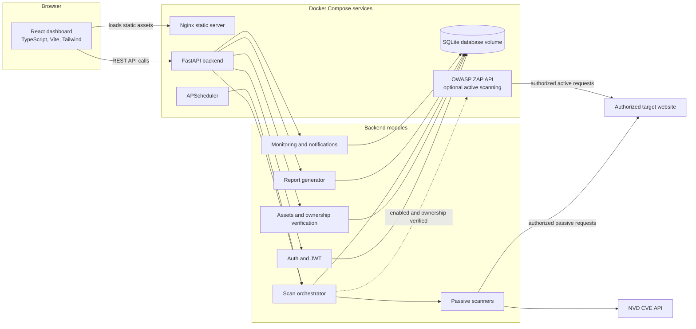
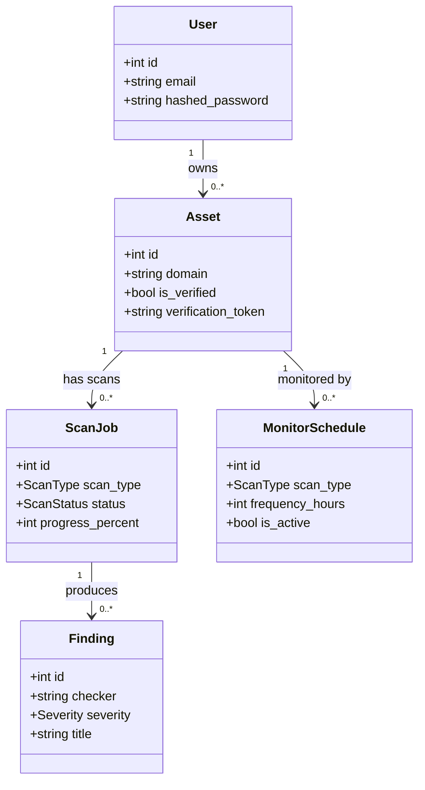

# SecureScan AI

SecureScan AI is a web application for authorized website security assessments. It combines a FastAPI service, a React dashboard, passive security checks, ownership verification, scan reports, recurring monitoring, and an optional OWASP ZAP integration for active testing.

This repository contains an MVP. It is intended for local development and controlled testing, not as a production-ready hosted security service.

## Features

- Password-protected login with per-user asset isolation
- Asset ownership verification through DNS TXT, an HTML meta tag, or a hosted verification file
- Passive checks for HTTP headers, TLS, cookies, CORS, exposed paths, email security records, HTTP methods, page content, technology fingerprints, and related issues
- Optional OWASP ZAP spidering and active scans for verified assets
- Scan progress, cancellation, findings, severity summaries, and risk scores
- JSON, HTML, PDF, and CSV report formats
- Recurring monitoring schedules and notifications logged by the backend
- English and Russian dashboard interface

## Architecture

The system-level flow is shown first, followed by a UML class diagram of the core persisted entities.





## Technology stack

| Area | Technologies |
| --- | --- |
| Backend API | Python 3.12, FastAPI, Pydantic Settings, SQLAlchemy |
| Authentication | JWT (HS256), PBKDF2-HMAC-SHA256 password hashing |
| Database | SQLite by default; a single persistent volume in Compose |
| Scanning | Python passive checks, dnspython, Requests, optional OWASP ZAP |
| Monitoring | APScheduler, process-local in-memory scan rate limiter |
| Reports | JSON, Jinja2 HTML, FPDF2 PDF, Python CSV |
| Dashboard | React 18, TypeScript, Vite, Tailwind CSS, Recharts, Lucide |
| Delivery | Docker Compose, Nginx, Python and Node containers |
| Tests | pytest, mocked passive scanner network calls, TypeScript production build |

## Quick start with Docker

Prerequisites: Docker Engine and the Docker Compose plugin.

```bash
cp docker-compose.env.example .env
```

Set a unique random value for `JWT_SECRET_KEY` in `.env`; it is always required. `ZAP_API_KEY` is needed only when you enable active scanning with `ZAP_ENABLED=true`. For local open access, set `AUTH_REQUIRED=false`; everyone using this local stack will share one guest workspace. Keep `PUBLIC_REGISTRATION_ENABLED=false` and `SEED_DEMO_DATA_ENABLED=false` unless explicitly needed. Do not expose this open mode to the internet. For hosted deployment, set `AUTH_REQUIRED=true` and provision the first account with `SEED_ADMIN_ENABLED=true`, `SEED_ADMIN_EMAIL`, and a unique `SEED_ADMIN_PASSWORD`.

```bash
docker compose up --build
```

- Dashboard: <http://localhost:8081>
- Backend API and Swagger UI: <http://localhost:8000/docs>
- ZAP API: bound to `127.0.0.1:8080`

With `AUTH_REQUIRED=false`, open the dashboard directly; no account is needed. The anonymous workspace is shared by all visitors, so use this only on a trusted local machine. With `AUTH_REQUIRED=true`, sign in using the bootstrap account configured in `.env`. Registration remains disabled unless explicitly enabled.

For manual setup, ownership verification, active-scan configuration, and troubleshooting, see [QUICKSTART.md](QUICKSTART.md).

## Security and responsible use

Only scan systems you own or are explicitly authorized to test. Passive checks still send network requests to the target. OWASP ZAP active scans send real test payloads and are disabled by default; enable them only after configuring ZAP and verifying ownership.

The MVP is not hardened for public internet deployment. Before hosting it for external users, add network egress controls against SSRF and private-address access, production TLS and CORS configuration, durable job processing, distributed rate limiting, operational monitoring, and a reviewed secrets-management process. JWTs are stored in browser `localStorage`; report download links use query-string tokens.

## Repository layout

```text
.
├── README.md                         # Project overview and architecture
├── QUICKSTART.md                     # Setup, launch, and troubleshooting
├── docker-compose.yml                # Local multi-service stack
├── docker-compose.env.example        # Compose environment template
├── securescan-mvp/                   # FastAPI backend and scanners
└── securescan-dashboard/             # React + TypeScript dashboard
```

The optional `SecureScan_AI_Architecture.docx` is a planning document. Review it for confidential or non-public material before publishing it.

## Documentation

- [Quick start and operations](QUICKSTART.md)
- [Backend details and API examples](securescan-mvp/README.md)
- [Dashboard setup](securescan-dashboard/README.md)
- [OWASP ZAP setup](securescan-mvp/app/scanners/active/README.md)

## Tests

```bash
cd securescan-mvp
python -m venv .venv
source .venv/bin/activate
pip install -r requirements-dev.txt
pytest

cd ../securescan-dashboard
npm ci
npm run build
```
